<div align="center">

<picture>
  <source media="(prefers-color-scheme: dark)" srcset=".github/assets/banner-dark.svg">
  
</picture>

**Test PAM Native code without a device, and certify screens when you have one.**<br>
Fake native modules with strict stubs, assert every bridge call, and reject black or transparent frames before comparing against a golden image.

[](https://packagist.org/packages/pushinbr/pam-native-testing)

[](https://github.com/push-in/pam-native-testing/actions/workflows/ci.yml)
[](LICENSE)

[Install](#install) · [Quick example](#quick-example) · [API](#api-guide) · [Checklist](#production-checklist) · [Docs](#docs) · [Issues](https://github.com/push-in/pam-native-testing/issues)

</div>

<a id="install"></a>
## <picture></picture> Install

Inside a PAM Native project, as a development dependency:

```sh
pam composer require --dev pushinbr/pam-native-testing
pam test
```

The package is plain PHP (no plugin manifest, no native code). `pam test` runs Pest or PHPUnit inside PAM. New to PAM? Create a project with `pam init my-app --template native` and run it with `pam mobile dev` (see the [PAM Native overview](https://push-in.github.io/pam-docs/native/overview/)), then come back here. Composer owns the manifest and the lockfile; `pam composer` runs it on PAM's verified PHP runtime. Remove it with `pam composer remove pushinbr/pam-native-testing`.

<a id="quick-example"></a>
## <picture></picture> Quick example

```php
<?php

use Pam\Native\Testing\NativeTestHarness;

$native = NativeTestHarness::install();
$native->succeed('auth.session', 'current', [
    'identifier' => 'user-1',
    'state' => 2,
]);

// Exercise production PHP code.

$native->assertCalled('auth.session', 'current');
$native->assertSatisfied();
NativeTestHarness::uninstall();
```

Responses can be immediate or deferred (`DispatchMode::Deferred`, then `flushOne()` or `flush()`). Unstubbed calls fail immediately, and `assertSatisfied()` detects unused responses and unflushed completions.

<a id="platform-support"></a>
## <picture></picture> Platform support

| Platform | Support | Notes |
| --- | --- | --- |
| PAM Native | `^0.8 \|\| ^0.9 \|\| ^0.10 \|\| ^1.0` | From `composer.json` |
| PHP | 8.5+ | Runs anywhere PHP runs: CI, desktop, device |
| Android / iOS | Captured RGBA frames | Visual checks take pixels captured by the platform; no native code in this package |

<a id="visual-certification"></a>
## <picture></picture> Visual certification

Visual certification is deterministic and framework-independent: provide the RGBA pixels captured by Android or iOS, reject black/transparent launch frames, and compare the result with a golden image using explicit channel and changed-pixel tolerances.

```php
use Pam\Native\Testing\Visual\GoldenComparator;
use Pam\Native\Testing\Visual\ScreenHealth;

$health = (new ScreenHealth())->inspect($capturedFrame);
$diff = (new GoldenComparator(channelTolerance: 0.01))->compare($golden, $capturedFrame);

if (!$health['healthy'] || !$diff->accepted) {
    throw new RuntimeException('Native screen failed visual certification.');
}
```

`$golden` and `$capturedFrame` are `PixelBuffer(width, height, rgba)` instances.

<a id="api-guide"></a>
## <picture></picture> API guide

| API | Responsibility |
| --- | --- |
| `NativeTestHarness` | Install and remove the fake native-module transport. |
| `FakeNativeModuleTransport` | Stub success/failure, record calls, defer responses, and assert completion. |
| `DispatchMode` | Choose immediate or deferred callback execution. |
| `RecordedModuleCall` | Inspect exact module, method, and payload calls. |
| `StubbedModuleResponse` | Describe deterministic native results. |
| `PixelBuffer` | Validate a platform-neutral RGBA screenshot contract. |
| `ScreenHealth` | Detect black and transparent startup frames. |
| `GoldenComparator` / `VisualDiff` | Certify screenshots with measurable tolerances. |

All coded states, kinds, and variants are sequential integer-backed enums. Use enum cases in application code; do not depend on raw wire numbers.

<a id="production-checklist"></a>
## <picture></picture> Production checklist

- Uninstall the harness during test teardown.
- Fail every unstubbed native call so tests cannot pass accidentally.
- Call `assertSatisfied()` to catch unused responses and pending completions.
- Run `pam doctor`, `pam test`, and a signed release build on every supported platform.
- Exercise denial, cancellation, backgrounding, process restart, and offline behavior before release.

<a id="troubleshooting"></a>
## <picture></picture> Troubleshooting

- **A test hangs:** flush deferred responses or change the dispatch mode.
- **An assertion sees extra calls:** reset or reinstall the harness per test.
- **Production transport leaks between tests:** enforce teardown even after failures.
- **Native integration is stale:** run `pam doctor --fix`, rebuild the native host, and inspect the first reported diagnostic.

Report security vulnerabilities through the repository security policy or GitHub private vulnerability reporting, not a public issue.

<a id="docs"></a>
## <picture></picture> Docs

- [Package guide on pam-docs](https://push-in.github.io/pam-docs/packages/native-testing/)
- [PAM Native overview](https://push-in.github.io/pam-docs/native/overview/)
- [Plugin and native capability model](https://push-in.github.io/pam-docs/native/plugins/)
- [Changelog](CHANGELOG.md)
- [Report an issue](https://github.com/push-in/pam-native-testing/issues)

<a id="pam-ecosystem"></a>
## <picture></picture> Part of the PAM ecosystem

PAM runs PHP natively on servers, desktops and phones. This repository is one piece of it.

| [**PAM**](https://github.com/push-in/pam) | [**PAM Desktop**](https://github.com/push-in/pam-desktop) | [**PAM Native**](https://github.com/push-in/pam-native) | [**Ecosystem**](https://github.com/push-in/pam#ecosystem) |
| --- | --- | --- | --- |
| the runtime and CLI | native desktop apps in PHP | native Android and iOS apps in PHP | every official package and plugin |

<sub>Docs: [push-in.github.io/pam-docs](https://push-in.github.io/pam-docs/introduction/) · [Issues](https://github.com/push-in/pam-native-testing/issues)</sub>

<p align="center"><sub><a href="LICENSE">Apache License 2.0</a> · Made in Brazil by Pushin</sub></p>
